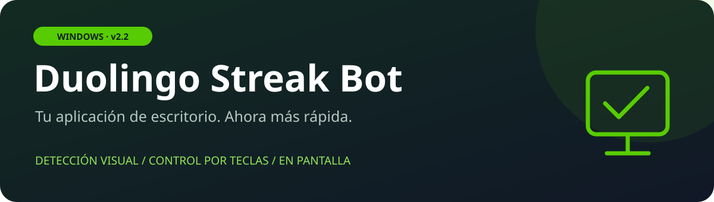

  
  
  

Aplicación de escritorio para automatizar los botones del recorrido de **Sonidos** de Duolingo. Reconoce los controles en pantalla, hace clic y se detiene al completar una lección en el modo de una racha.

**Esta publicación es la versión rápida de Windows, anterior al modo en segundo plano.** Necesita Duolingo visible y utiliza el ratón del ordenador. No incluye extensiones de Chrome ni el conector local.

## Descargar y empezar

1. Descarga **[Duolingo-Streak-Bot-2.2-Windows.zip](https://github.com/PapiGECode/duolingo-streak-keeper/releases/download/v2.2.0/Duolingo-Streak-Bot-2.2-Windows.zip)** y extrae su contenido.
2. Abre `Duolingo_Streak_Bot.exe`. No necesitas instalar Python ni Node.js.
3. Inicia sesión en tu propia cuenta de Duolingo. Usa la interfaz en **español**, con la sección **Sonidos** disponible.
4. Coloca Duolingo maximizado en el **monitor principal**, con zoom del navegador al **100 %**.
5. Selecciona el modo de **una racha** y pulsa **F6**. Deja libre el ratón durante la ejecución.
6. Comprueba el resultado en Duolingo al terminar. **F8** detiene el bot en cualquier momento.

También está disponible el [ejecutable suelto](https://github.com/PapiGECode/duolingo-streak-keeper/releases/download/v2.2.0/Duolingo_Streak_Bot.exe). Para usar la programación diaria, utiliza el ZIP y la instalación opcional descrita en la [guía](docs/USO.md).

## Qué incluye

| Función | Comportamiento |
| --- | --- |
| Detección rápida | Busca los controles en zonas concretas de la pantalla. |
| Pausa corta | 20 ms por defecto entre acciones distintas; 180 ms como mínimo al repetir el mismo botón. |
| Escalado de Windows | Ajusta las coordenadas según el DPI de la ventana. |
| Ejercicios de voz | Pulsa **«No puedo hablar ahora»**. |
| Otros ejercicios | Reconoce **Saltar**, **Continuar**, **No gracias** y el inicio de Sonidos. |
| Calibración | Conserva las plantillas personalizadas entre ejecuciones. |
| Programación opcional | Tarea local de Windows, con el equipo encendido y la sesión desbloqueada. |

La pausa de 20 ms no es la duración de la lección: también influyen la captura, la detección, las animaciones y la conexión. El bot depende del diseño de Duolingo y de que el recorrido de Sonidos permita completar la lección con esos controles. No garantiza una racha en todas las cuentas, cursos o versiones de la web.

## Controles

| Tecla | Acción |
| --- | --- |
| **F6** | Iniciar / pausar |
| **F7** | Solo cámara de detección |
| **F8** | Parada de emergencia |

## Ayuda y detalles

- [Guía de uso, instalación y solución de problemas](docs/USO.md)
- [Cambios de la versión 2.2](CHANGELOG.md)
- [Verificación del ejecutable publicado](docs/VERIFICACION.md)
- [Informar de un problema](https://github.com/PapiGECode/duolingo-streak-keeper/issues/new?template=bug_report.yml)

## Sobre este repositorio

La aplicación original se conservaba únicamente como ejecutable. Esta publicación distribuye la copia **2.2-speech**, junto con documentación y scripts de instalación; **no contiene el código fuente completo de la aplicación ni permite recompilarla desde cero**.

El proyecto anterior de Playwright sigue disponible en el [historial anterior a esta publicación](https://github.com/PapiGECode/duolingo-streak-keeper/tree/df0000ef9b5cdf0cf1bdddba4ac7666cdb690dd5). Sus tareas automáticas y su estado de sesión no forman parte de esta edición de escritorio.

Proyecto independiente de **PapiGECode**, sin afiliación con Duolingo. Las marcas pertenecen a sus respectivos titulares. El ejecutable incluye bibliotecas de terceros que conservan sus propias licencias.
